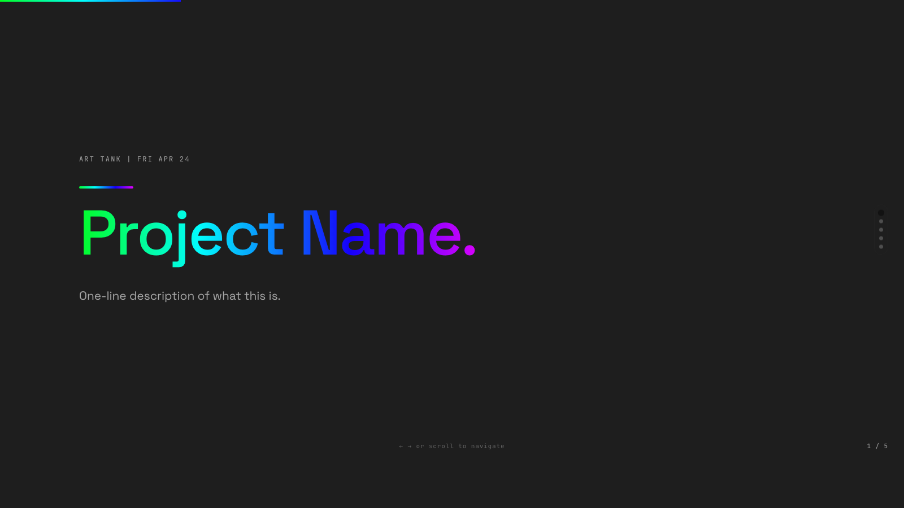
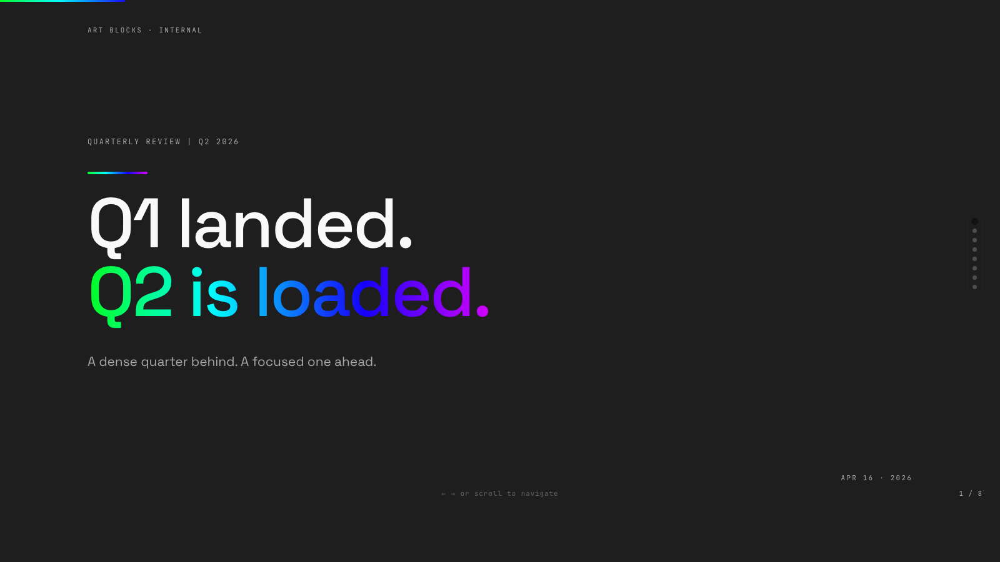

# ab-deck

Make a polished, AB-branded presentation deck from a simple outline.

No Keynote. No PowerPoint. No design skills needed.

---

## Make a deck in 60 seconds

1. **Copy an example.** Pick the one closest to what you need:

   | Example | Use for |
   |---------|---------|
   | [`art-tank-pitch.md`](examples/art-tank-pitch.md) | 5-slide Product Lab pitch |
   | [`team-update.md`](examples/team-update.md) | Monthly or weekly update |
   | [`quarterly-review.md`](examples/quarterly-review.md) | Full quarterly review |

2. **Edit the text.** Replace the placeholder content with yours.

3. **Ask Claude to build it.**

   - **Claude Code:** *"Use ab-deck to build this outline:"* and paste your edited file.
   - **Claude.ai / Cowork / Cursor / any Claude:** follow the [Cowork guide](COWORK.md) — paste [`PROMPT.md`](PROMPT.md), then the template, then your outline.

4. **Save, open, present.** You get an HTML file — double-click to open in a browser, or export to PDF.

That's it.

---

## What you get

### Art Tank pitch



### Team update


### Quarterly review



---

## How a slide looks in the outline

```
## slide: split
label: A1
heading: New Visitor Experience.
subhead: Nothing else matters if people bounce.
bullets:
  - "**The gap.** 88 of 100 visitors leave without doing anything."
  - "**The wave.** Non-crypto users arriving this summer."
  - "**Q2's job.** Build the front door."
```

- Wrap text in `[[like this]]` to get the rainbow highlight.
- Start a bullet with `**bold.**` to get the bold-leader-then-dim-description style.

Everything else you need — all the slide types, what fields to use — is in `SKILL.md`. Claude reads that automatically.

---

## Getting a PDF

Open the HTML in your browser. `Cmd+P` → Save as PDF → Landscape. Done.

(If you're on Claude Code and have Chrome installed, you can also run `./build.sh your-deck.html` and get a landscape dark-mode PDF in one command.)

---

## Claude Code setup (one-time)

If you're using Claude Code, run this once so the skill is available in every session:

```bash
git clone git@github.com:jordanlyall/ab-deck.git
cd ab-deck
./install.sh
```

Then just say *"make me a deck"* and Claude will know what to do.

---

## Questions

Ping @jordanlyall on Slack.
